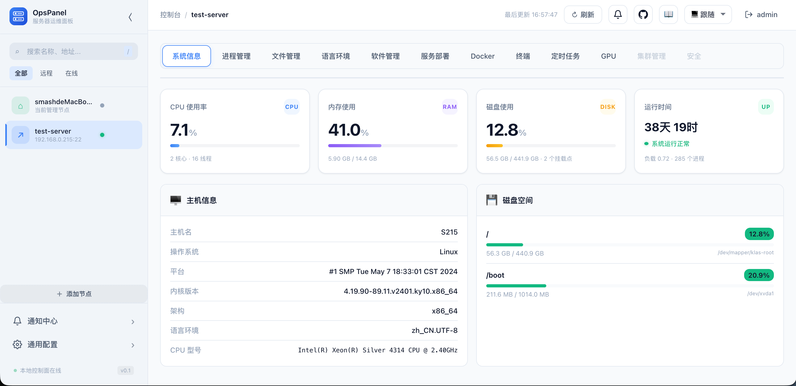
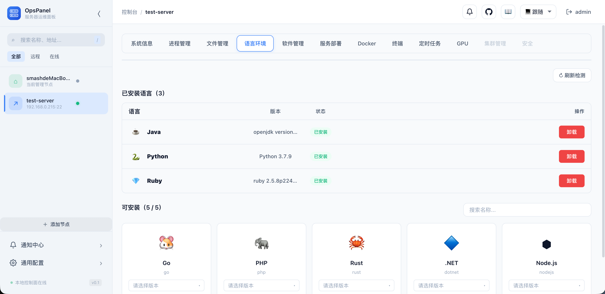
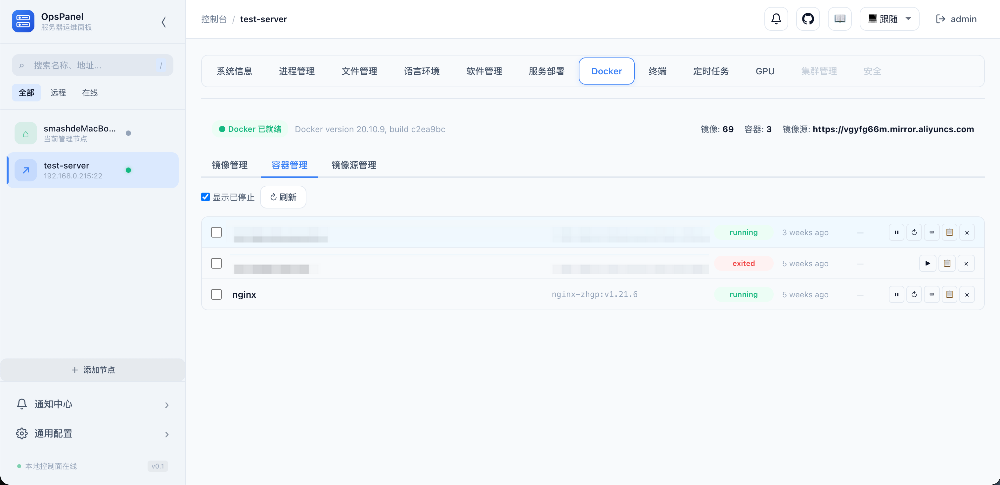
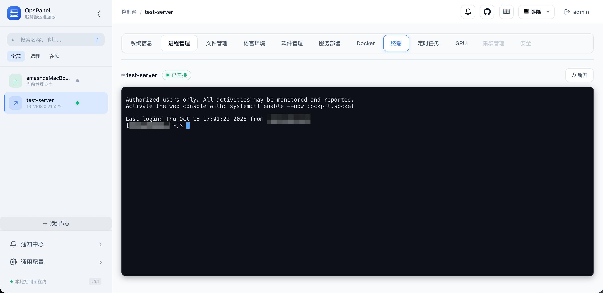
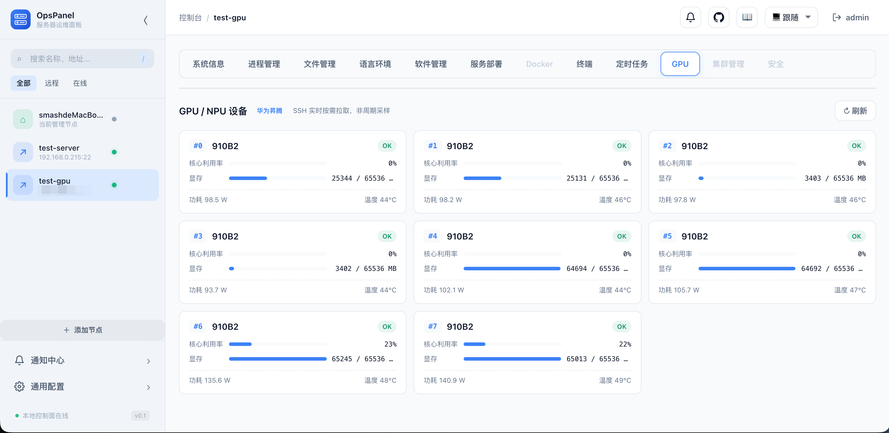
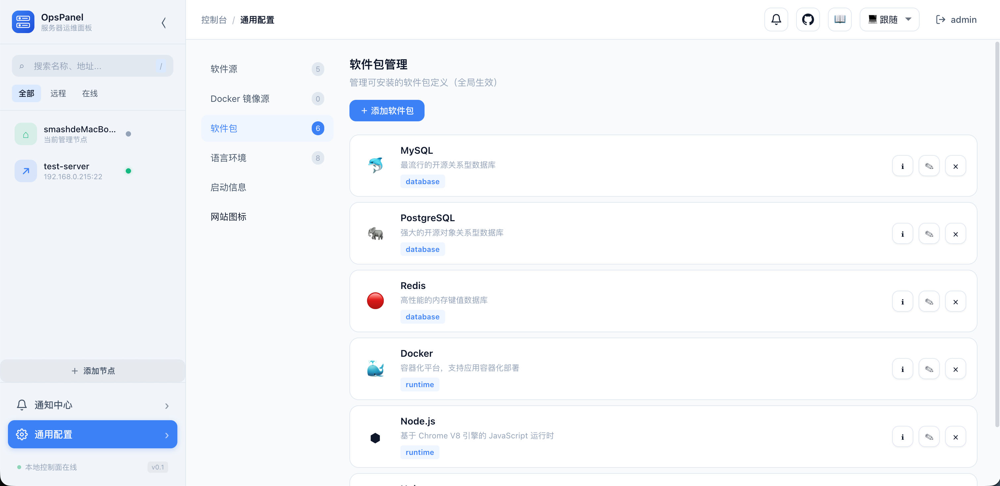
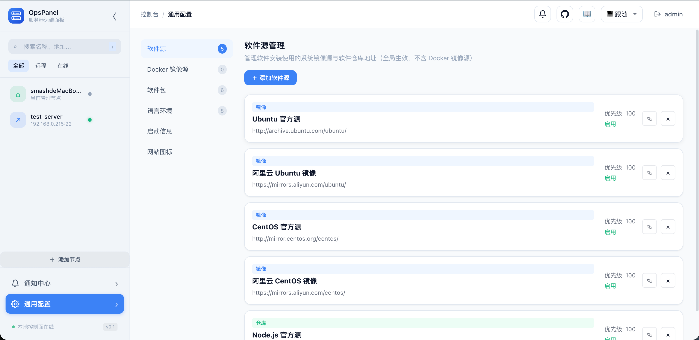

# OpsPanel

简体中文 | [English](README.md)

**单二进制、零 Agent、零依赖的轻量服务器运维面板。**

[](https://golang.org)
[](LICENSE)
[](#部署)

## 这是什么

OpsPanel 是一个原生 Go 编写的服务器运维面板：**单个二进制 + 内嵌前端 + SQLite，零外部依赖、零 Agent**。只要目标服务器开着 SSH，就能在浏览器里获得完整控制台。所有数据留在本地，无云端、无遥测。

```bash
git clone https://github.com/smash-hq/opspanel.git
cd opspanel && make run
# 打开 http://localhost:18080 （默认账号 admin / admin123，请尽快修改密码）
```

## 界面一览

**系统信息 · 实时监控** —— CPU / 内存 / 磁盘 / 网络一目了然



**语言环境** —— 自动检测已装语言，一键安装卸载



**Docker** —— 镜像与容器管理、容器终端



**Web 终端** —— 浏览器直连服务器 Shell



**GPU / NPU** —— 显卡信息与利用率监控



**软件包管理** —— 软件商店一键安装卸载



**软件源管理** —— apt / yum / apk 源可视化管理



## 能做什么

| 模块 | 功能 |
|------|------|
| 🖥️ 实时监控 | CPU / 内存 / 磁盘 / 网络，WebSocket 3 秒推送 |
| 📦 软件商店 | MySQL / Redis / Nginx 等一键安装卸载、服务启停、自定义包与源 |
| 🌐 语言环境 | Go / Java / Python 等 8 种语言自动检测、多版本管理 |
| 🐳 Docker | 镜像 / 容器管理、容器终端与日志、批量操作 |
| 📁 文件管理 | 目录浏览、文本预览、下载 |
| ⚙️ 进程管理 | 进程列表、终止进程、日志查看 |
| 🚀 应用部署 | 分片上传部署、远程启停重启、日志查看 |
| ⏰ 定时任务 | crontab 可视化、表达式校验与执行预览 |
| 🔔 通知中心 | 站内通知 + SMTP 邮件、应用异常自动告警 |
| 🎮 GPU/NPU | 昇腾 / 寒武纪设备信息（功耗 / 温度 / 利用率 / 显存） |
| ⌨️ Web 终端 | 浏览器交互式 SSH 终端 |
| 🔐 登录认证 | 单管理员、bcrypt、Cookie 会话 |

适合个人开发机、小团队内网服务器的轻量运维，Linux arm64 开箱即用（鲲鹏 / 飞腾等国产平台）。

## 部署

### 源码运行

```bash
make run                    # 前台运行（Ctrl+C 停止）
make dev                    # 开发模式，前端改动刷新即生效
make build && ./opspanel    # 手动构建后运行
```

### Linux 二进制

```bash
make build-linux          # linux/amd64
make build-linux-arm64    # linux/arm64（鲲鹏 / 飞腾）

sudo mkdir -p /opt/opspanel/data
sudo cp opspanel /opt/opspanel/ && sudo chmod +x /opt/opspanel/opspanel
cd /opt/opspanel && ./opspanel
```

### 配置

默认监听 `0.0.0.0:18080`，数据存于 `./data`。可通过环境变量（`OPSPANEL_SERVER_PORT`、`OPSPANEL_SERVER_HOST`、`OPSPANEL_SERVER_DATA_DIR`、`OPSPANEL_LOG_LEVEL` 等）或配置文件调整，完整示例见 [config.example.yaml](config.example.yaml)，用 `./opspanel --config /etc/opspanel/config.yaml` 指定路径。

> 反向代理部署时，`/ws` 路径需支持 WebSocket 升级。常用管理命令：`make stop` / `make restart` / `make status`。

## 风险提示

**使用前请务必阅读 [SECURITY.md](SECURITY.md) 与 [LICENSE](LICENSE)：**

1. **仅限内网 / 受信环境使用，切勿暴露公网**——面板仅有单管理员登录，无 HTTPS、无 MFA、无审计日志、无登录失败锁定。
2. **SSH 凭据存于本地 SQLite**（受文件权限保护），不适合生产或高安全要求环境。
3. **本软件会对远程服务器执行命令（含 sudo）**，误操作可能导致配置变更、数据丢失或服务中断，使用风险自负。
4. 开发者不对使用本软件产生的安全问题承担责任，详见 LICENSE 第 7 条。

**安全建议**：反向代理启用 HTTPS · 防火墙限制访问来源 · 优先 SSH 密钥认证 · 远程用户仅授权最小 NOPASSWD 命令集 · 定期备份 `data/opspanel.db`。

## 参与开发

欢迎一起完善！Issue 和 PR 都欢迎：软件目录与语言环境定义、新功能、文档都是很好的切入点，开发指引见 [CONTRIBUTING.md](CONTRIBUTING.md)。

## License

[Non-Commercial Use License](LICENSE)——个人学习与组织内部运维免费使用，商业用途需授权。
